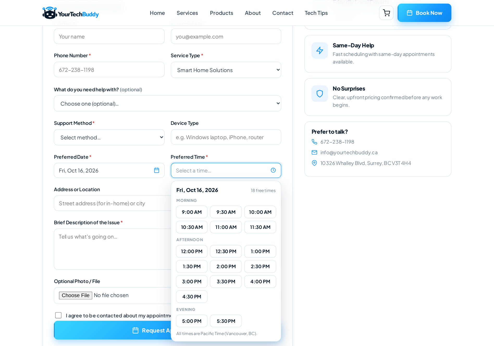
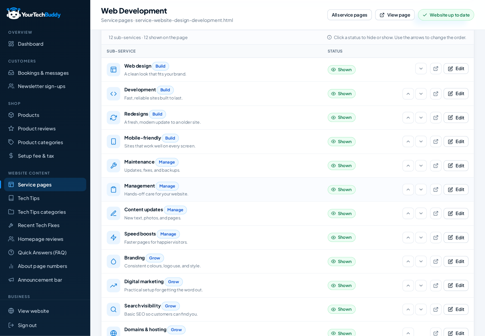

# YourTechBuddy Website

This is the website I designed and built for YourTechBuddy, a tech-support business I co-founded. We're based in Surrey, BC and work with homes and small businesses across Metro Vancouver.

The site covers our four services (smart homes, Wi-Fi and networking, tech support, and web development). Customers can book an appointment online, buy from a small product shop and leave reviews, and there's a set of how-to articles. Behind the public pages there's an admin dashboard where we update content, handle bookings and messages, and approve reviews without touching the code.

**Live site:** [yourtechbuddy.ca](https://yourtechbuddy.ca)

| | |
|---|---|
| **Role** | Co-founder, designer and developer |
| **Type** | Small-business website with booking, shop, articles and an admin dashboard |
| **Built with** | HTML, CSS, JavaScript, PHP, MySQL |
| **Year** | 2026 |
| **Source code** | Private, available on request |

> This repository is a showcase of the project: screenshots and a write-up. The source code isn't included.

---

## Contents
- [My role](#my-role)
- [Screenshots](#screenshots)
- [Features](#features)
- [Challenges and solutions](#challenges-and-solutions)
- [Built with](#built-with)
- [Contact](#contact)

---

## My role

I took the website from a blank page to launch. I worked out what the business actually needed online, grouped our services into four categories, planned the pages and navigation, and wrote most of the copy.

I built the front end by hand with HTML, CSS and JavaScript, without a framework. Early on I set up a small design system (colours, spacing, cards and icons) so that the 50 or so pages look like they belong together.

Later I added a back end with PHP and MySQL for online booking, the product catalogue, customer reviews, email notifications and the admin dashboard. I used AI coding tools for a good part of that code. My part was deciding what each feature had to do, reviewing what came back, testing it on desktop and phone, and deploying each version.

---

## Screenshots

### Homepage
A short headline, a one-line summary of what we do, two buttons and four small trust badges.

### Call to action and footer
The closing banner, followed by a footer with quick links, the four services, contact details, opening hours and a newsletter sign-up.

### Services overview
Four value points, then the four service categories, each with its own image, summary and button.

### Service page: Smart Home Solutions
Every service page has a "What We Help With" grid like this one, plus links to related services in case a visitor's problem fits better somewhere else.

### Product shop
Category filters, badges, prices, Add to Cart buttons and a detail page for each product.

### About
The four things we care about most: Friendly First, Honest & Transparent, Fast & Reliable, and Plain-English Help.

### Contact
Contact cards, a contact form, and panels for support hours, response time and the area we cover.

### Tech Tips
Short how-to guides that can be filtered by topic.

### Online booking
You pick a day from a small calendar, then a time from the slots that are actually free that day.

### Admin dashboard
This is where we run the site from. The screenshot shows the "What We Help With" tiles for one of the service pages. We can add, edit, hide or reorder them, and the public page updates as soon as we save.

---

## Features

- **Four service pages.** Each one has a "What We Help With" grid, a few real customer scenarios ("Sound familiar?") and links to related services.
- **Three ways to get help:** in-home visits, remote support or drop-off.
- **Online booking.** The calendar only offers days and times that are free, based on our opening hours, holidays and existing bookings. The customer gets a confirmation email with a reference number and we get a copy with all the details. The booking buttons on the service pages open the form with that service already selected.
- **Contact form and newsletter.** Both are saved to the database, and we get an email when something new comes in.
- **Product shop.** 12 products with category filters, up to three photos each, a cart that remembers what you added, and optional setup help. Checkout is a demo, so no payment is taken.
- **Customer reviews.** Star ratings, written reviews and photos. We approve each review before it goes live, the average rating only counts approved reviews, and we can reply under a review.
- **Tech Tips.** 12 how-to articles, written and published from the dashboard.
- **Admin dashboard.** Bookings and messages, newsletter sign-ups (with CSV export), products, reviews, service pages, articles, homepage content, FAQ, business details, opening hours and an announcement bar.
- **Fast pages.** Content is kept in the database, but the public pages are published as plain HTML, so they load quickly.
- **Responsive** from 320px phones up to 1920px desktops.

---

## Challenges and solutions

A few of the problems I ran into, and how I dealt with them. When I got stuck I searched around and used AI tools to narrow down the cause, then tested the fix on different devices.

| Challenge | Solution |
|---|---|
| We listed too many separate services, and visitors had trouble finding the right one. | I grouped them into four categories, gave each its own page, and redirected the old page addresses so no links broke. |
| Some buttons needed two clicks, because the hover animation moved the card (and the button) away from the pointer. | I made each button's invisible click area larger, so it still catches the click while the card moves. |
| On phones, the current page in the mobile menu sat further right than the other items. | The active link had extra left padding. Removing it lined everything up again. |
| Text on small screens broke in odd places, like a dash starting a new line or "Wi-Fi" splitting in two. | I changed the line-wrapping rules, kept hyphenated words together and rewrote some long messages as two short lines. |
| We wanted to update content without editing code, but the pages still had to load fast. | The dashboard saves changes to the database and then writes them into the static pages, so visitors still get plain HTML. |
| Picking a date and time meant scrolling through long dropdown lists. | I replaced them with a small calendar and a grid of time slots that only shows free times. Both work with a mouse, touch or keyboard. |
| Two people could try to book the same time slot. | The server checks the slot again before saving. If someone just took it, the customer is asked to pick another time. |
| Product ratings had to be genuine. | Every review is approved before it appears, and the average only counts approved reviews. |
| With this many pages, every change had to work on every screen size. | I checked each change at widths from 320px phones to 1920px desktops, looking for sideways scrolling, clipped text, broken images and missed taps. |

---

## Built with

| Area | Tools |
|---|---|
| Front end | HTML5, CSS3 (custom properties, Grid, Flexbox), vanilla JavaScript |
| Back end | PHP |
| Database | MySQL |
| Font | Plus Jakarta Sans (Google Fonts) |

---

## Contact

YourTechBuddy helps homes and small businesses across Metro Vancouver with everyday technology.

- **Website:** [yourtechbuddy.ca](https://yourtechbuddy.ca)
- **Email:** info@yourtechbuddy.ca

If you'd like to look at the source code for a job application, please get in touch.

© 2026 YourTechBuddy. All rights reserved. See [LICENSE](LICENSE).
