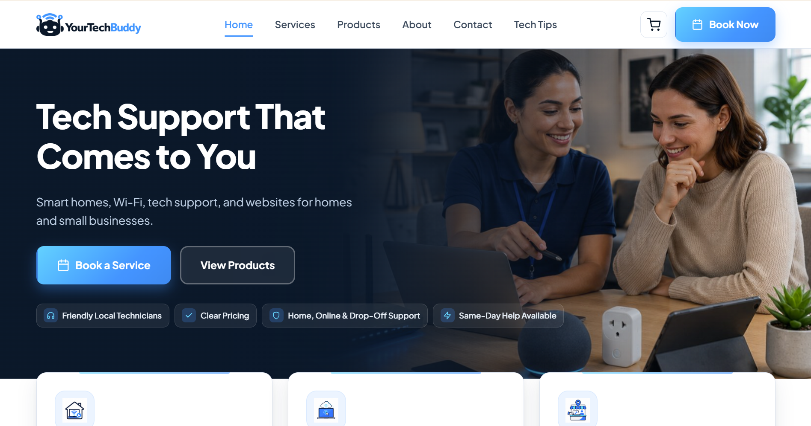
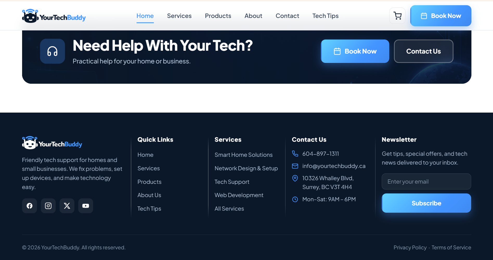
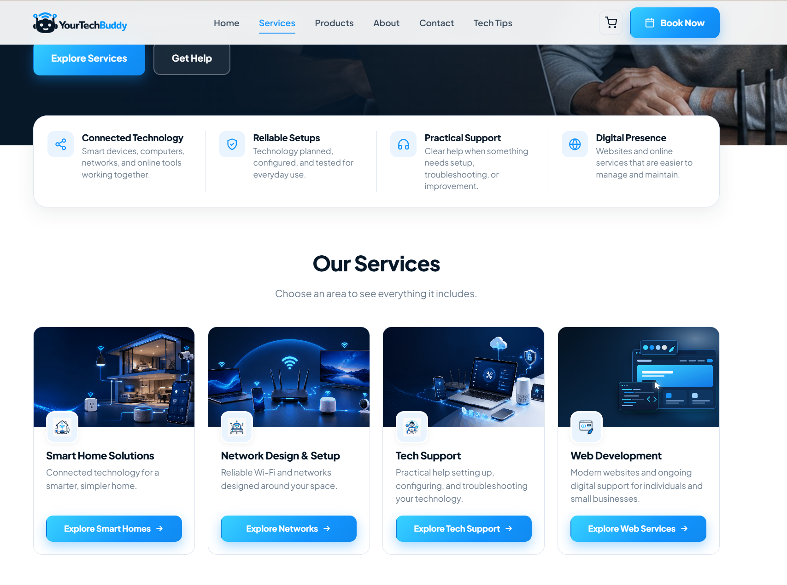
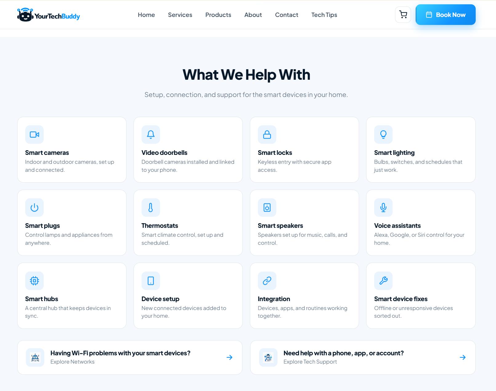
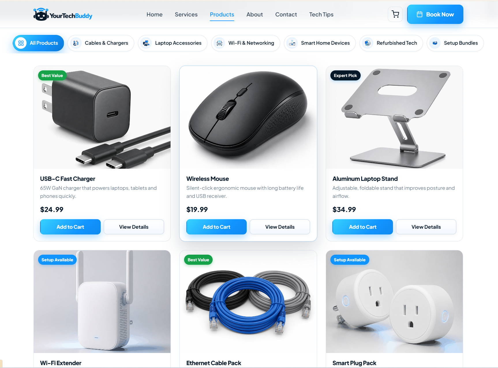
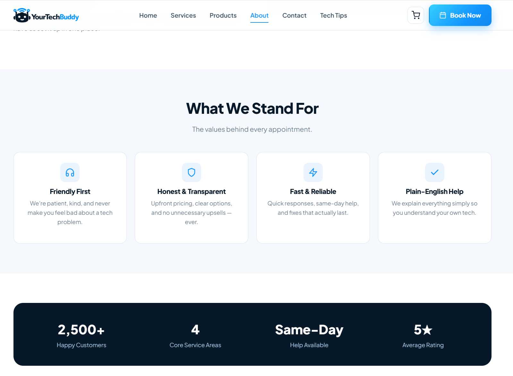
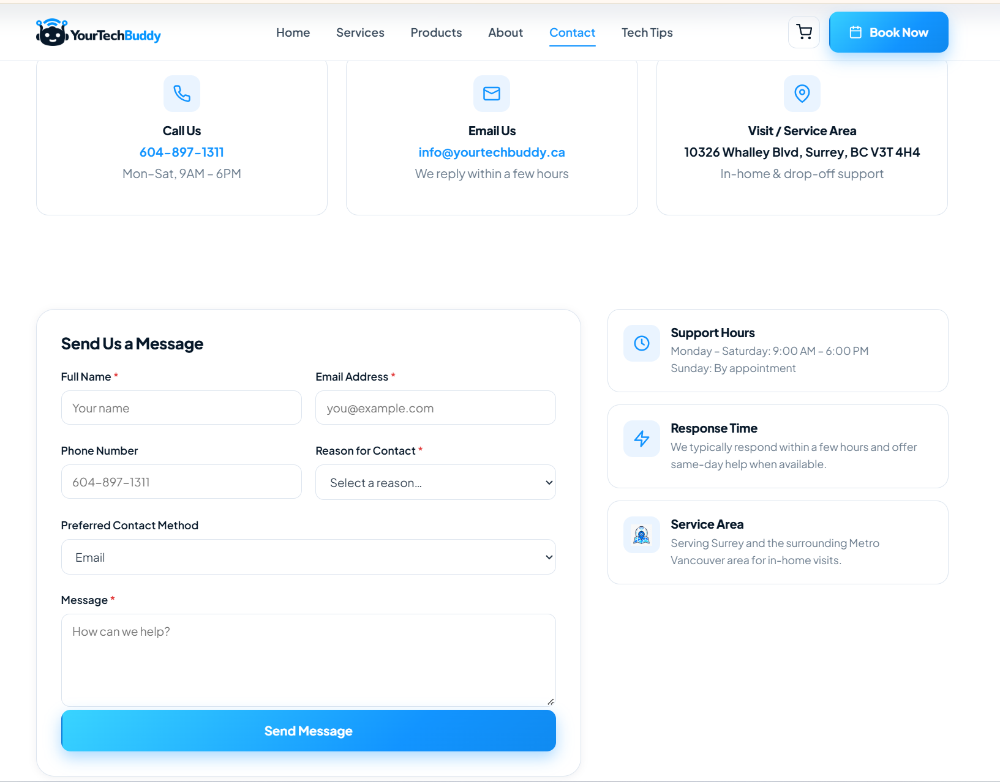
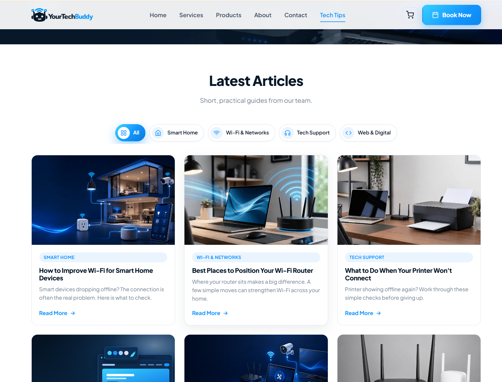

# YourTechBuddy: Business Website

A modern, responsive multi-page website for **YourTechBuddy**, a local tech-support business in Surrey, BC. It brings together four services (smart homes, Wi-Fi and networking, tech support, and web development), a product shop, a booking flow and a library of practical tech guides.

**Live site:** [yourtechbuddy.ca](https://yourtechbuddy.ca)

| | |
|---|---|
| **Role** | Co-founder; designer and developer of the website |
| **Type** | Small-business website with shop, booking and articles |
| **Built with** | HTML, CSS, JavaScript (no frameworks) |
| **Year** | 2026 |
| **Source code** | Private, available on request |

> **Note:** This repository is a visual showcase of the project. It contains screenshots and a project write-up only. The source code is private.

---

## Contents
- [My Role](#my-role)
- [Screenshots](#screenshots)
- [Features](#features)
- [Challenges and Solutions](#challenges-and-solutions)
- [Built With](#built-with)
- [Contact](#contact)

---

## My Role

I'm a co-founder of YourTechBuddy, and I designed and built the company website from idea to launch.

- **Defined the requirements:** I decided what the business needed online: four service areas, a product shop, booking and contact forms, and a Tech Tips section.
- **Shaped the structure and content:** I reorganised the services into four clear categories, chose the pages and navigation, and decided on the wording, business details and calls to action.
- **Designed and developed the site:** I built the pages with HTML, CSS and JavaScript, set up the shared design system (colours, spacing, cards and icons) and kept the branding consistent across about 50 pages.
- **Tested and refined:** I checked every page on desktop and phone and refined the layout until it worked well on every screen size.

---

## Screenshots

### Homepage
The hero gives a clear headline, a one-line summary of the services, two calls to action, and four trust badges.

### Call to Action and Footer
A closing call-to-action banner sits above a footer that holds quick links, the four service areas, contact details, business hours and a newsletter sign-up.

### Services Overview
Four value points in a single panel, followed by the four main service categories, each with its own illustration, summary and button.

### Service Page: Smart Home Solutions
A 12-tile "What We Help With" grid, with links to related services for visitors whose problem fits another area.

### Product Shop
The catalogue has category filters, product badges, prices, Add to Cart buttons and detail pages.

### About
Four value cards set out what the business stands for: Friendly First, Honest & Transparent, Fast & Reliable, and Plain-English Help.

### Contact
The page has contact cards, a validated contact form, and panels for support hours, response time and service area.

### Tech Tips
Short, practical guides that can be filtered by topic: Smart Home, Wi-Fi & Networks, Tech Support, and Web & Digital.

---

## Features

- **Four service areas:**
  - Smart Home Solutions;
  - Network Design & Setup;
  - Tech Support;
  - Web Development.

  Each has its own page with a "What We Help With" grid, real customer scenarios ("Sound familiar?") and links to related services.
- **Three ways to get help:** in-home, online remote, and drop-off support.
- **Booking and contact forms:**
  - input is validated in the browser;
  - links can pre-select a service or contact reason, so a "Book" button on a service page opens the form with that service already chosen.
- **Product shop:**
  - 12 products with category filters and product detail pages;
  - a cart that is saved in the browser;
  - optional setup add-ons;
  - a checkout page that works through the full flow. It is a demo, so no real payment is processed.
- **Tech Tips:** 12 how-to articles with topic filters.
- **Fully responsive:** the layouts adapt from 320px phones to 1920px desktops, and the mobile menu slides in.
- **Consistent design system:** shared colours, spacing, card styles and icon set across about 50 pages.

---

## Challenges and Solutions

These are some of the problems I ran into while building and refining the site. When I got stuck, I researched online and used AI tools to help pin down the cause and compare possible fixes. Then I applied the solution and tested it across devices.

| Challenge | Solution |
|---|---|
| The site offered too many separate services, which made it hard for visitors to find the right help. | I grouped the services into four clear categories, each with its own page, and set up redirects from the old page addresses so no links would break. |
| Buttons sometimes needed two clicks: hover animations lifted the cards, moving the button away from the pointer. | I extended each button's invisible click area so it still catches the click while the card moves, so every button works on the first click or tap. |
| On phones, the current page in the mobile menu shifted to the right, out of line with the other items. | I tracked it to extra left padding on the active link and removed it, so every row uses the same alignment and the labels and arrows line up. |
| Text on small screens broke awkwardly, with a dash starting a new line and "Wi-Fi" splitting in two. | I adjusted the line-wrapping rules, kept hyphenated words together, and rewrote long messages as clear two-line statements. |
| The site has many pages and needed to work on every screen size. | I checked each change at widths from small phones (320px) to large desktops (1920px), looking for horizontal scrolling, clipped text, broken images and missed clicks. |

---

## Built With

| Area | Tools |
|---|---|
| Structure | HTML5 |
| Styling | CSS3 (custom properties, Grid, Flexbox, responsive media queries) |
| Interactivity | Vanilla JavaScript (menu, filters, carousels, form validation, cart) |
| Typography | Plus Jakarta Sans (Google Fonts) |

---

## Contact

YourTechBuddy offers friendly, practical technology help for homes and small businesses in Surrey and the surrounding Metro Vancouver area.

- **Website:** [yourtechbuddy.ca](https://yourtechbuddy.ca)
- **Email:** info@yourtechbuddy.ca

To review the source code for a job application, please get in touch.

© 2026 YourTechBuddy. All rights reserved. See [LICENSE](LICENSE).
