# YourTechBuddy Website

This is the website I designed and built as the web developer for YourTechBuddy, a local IT support company for small businesses across Metro Vancouver.

The site presents the company's two services, IT Support and Web Development, with clear monthly IT plans, one-time website packages and website care plans. Visitors can book a free IT assessment online, buy from a small tech shop and read how-to articles. Behind the public pages there's an admin dashboard where the team updates content, handles bookings and messages, and approves reviews without touching the code.

**Live site:** [yourtechbuddy.ca](https://yourtechbuddy.ca)

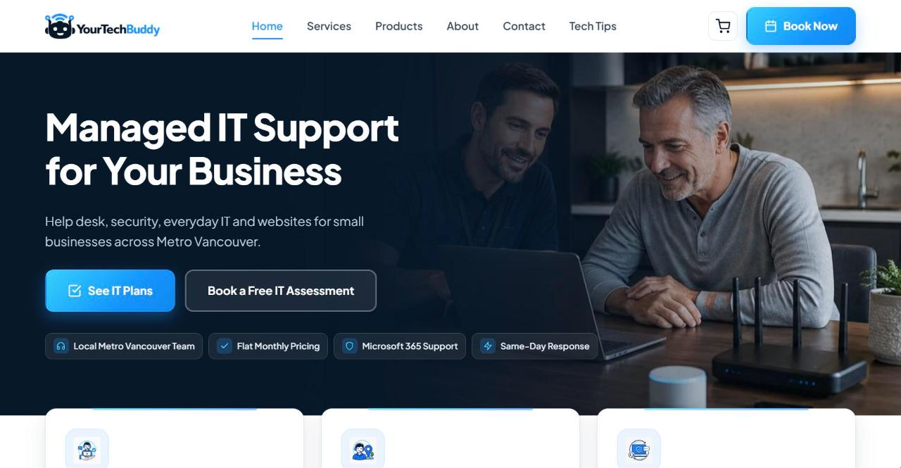

| | |
|---|---|
| **Role** | Web Developer (design, front end, back end and deployment) |
| **Type** | Small-business website with pricing plans, booking, shop, articles and an admin dashboard |
| **Built with** | HTML, CSS, JavaScript, PHP, MySQL |
| **Timeline** | 2025 – present |
| **Source code** | Private, available on request |

> This repository is a showcase of the project: screenshots and a write-up. The source code isn't included.

---

## Contents
- [My role](#my-role)
- [Screenshots](#screenshots)
- [Features](#features)
- [Challenges and solutions](#challenges-and-solutions)
- [Built with](#built-with)
- [Contact](#contact)

---

## My role

I'm the web developer on the YourTechBuddy team, and I took the website from a blank page to launch. I worked with the team to understand what the business needed online, planned the pages and navigation, and wrote much of the copy.

I built the front end by hand with HTML, CSS and JavaScript, without a framework. Early on I set up a small design system (colours, spacing, cards, pricing cards and icons) so that the 50 or so pages look like they belong together.

Later I added a back end with PHP and MySQL for online booking, the product catalogue, reviews, email notifications and the admin dashboard. I used AI coding tools for a good part of that code. My part was deciding what each feature had to do, reviewing what came back, testing it on desktop and phone, and deploying each version.

When the business moved its focus from home tech support to managed IT for small businesses, I reworked the site to match: a new homepage, two focused service pages, per-user IT plans, website packages and care plans, and new booking options for a free IT assessment.

---

## Screenshots

### Homepage
A short headline, a one-line summary of the services, two buttons and four small trust badges.

### IT Support Plans
Three monthly plans (Basic, Plus and Pro) with one flat price per user, minimum team sizes and what each plan adds.

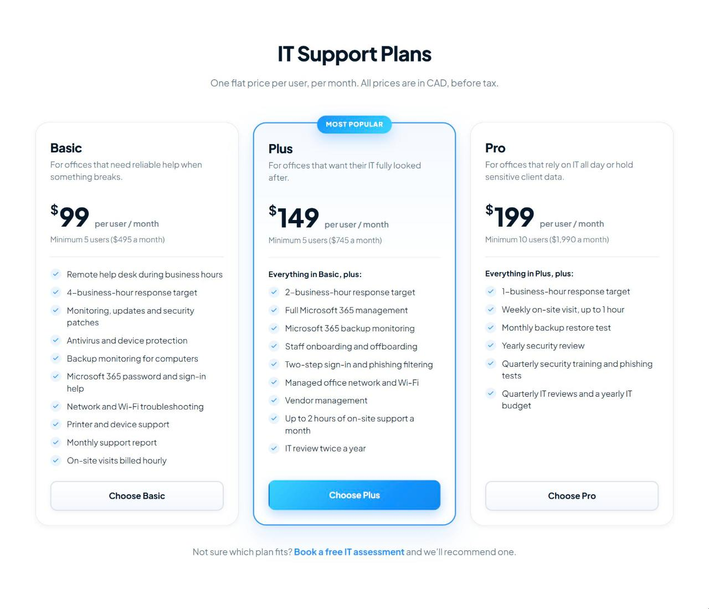

### Call to action and footer
The closing banner, followed by a footer with quick links, services, contact details, opening hours and a newsletter sign-up.

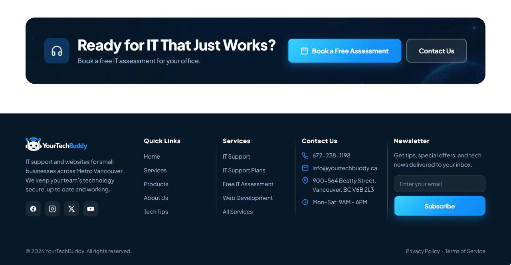

### Services overview
The two services, IT Support and Web Development, each with its own image, summary and button.

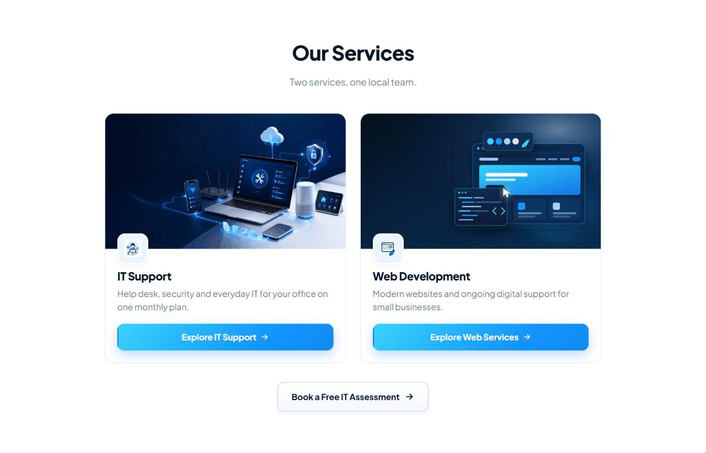

### Service page: IT Support
Every service page has a "What We Help With" grid like this one, plus links to a free IT assessment and to the other service.

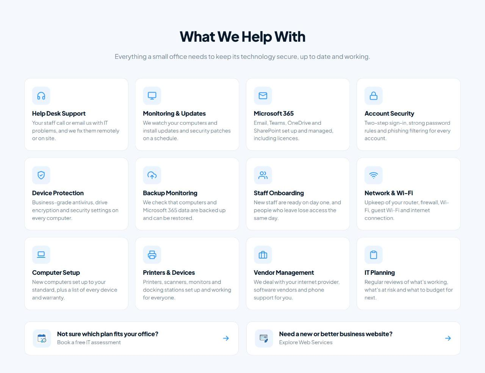

### Service page: Web Development
One-time website packages (Starter, Business and Growth). The page also lists monthly website care plans.

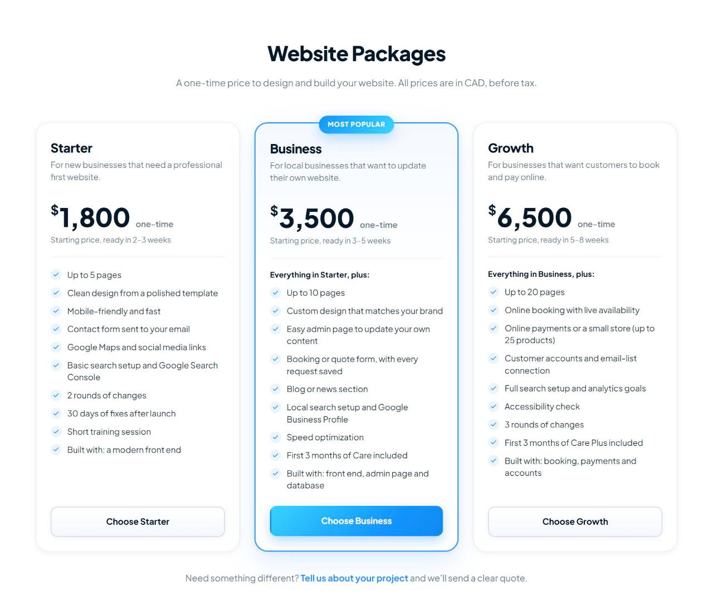

### Product shop
Category filters, badges, prices, Add to Cart buttons and a detail page for each product.

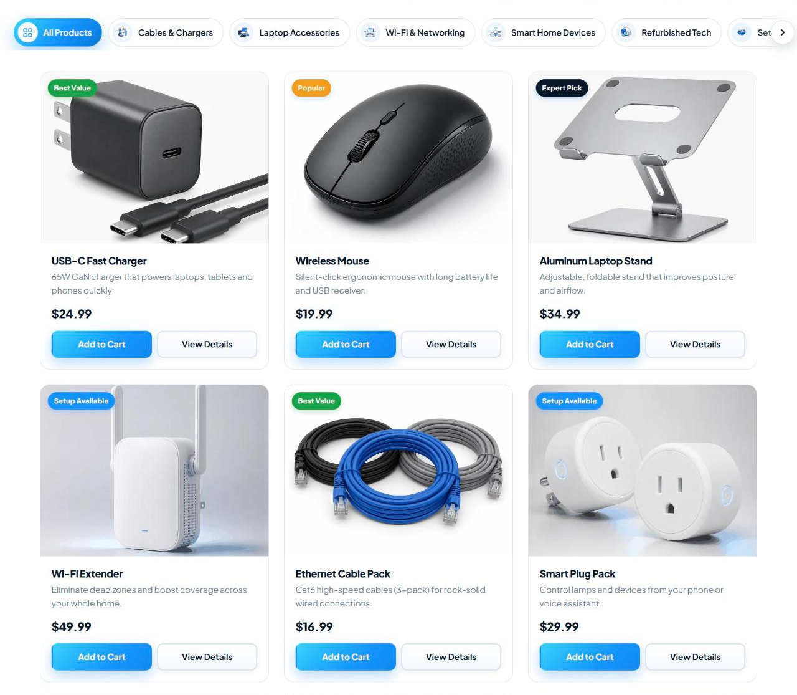

### About
The four values behind the business: Friendly First, Always Honest, Fast & Reliable, and Clear Answers.

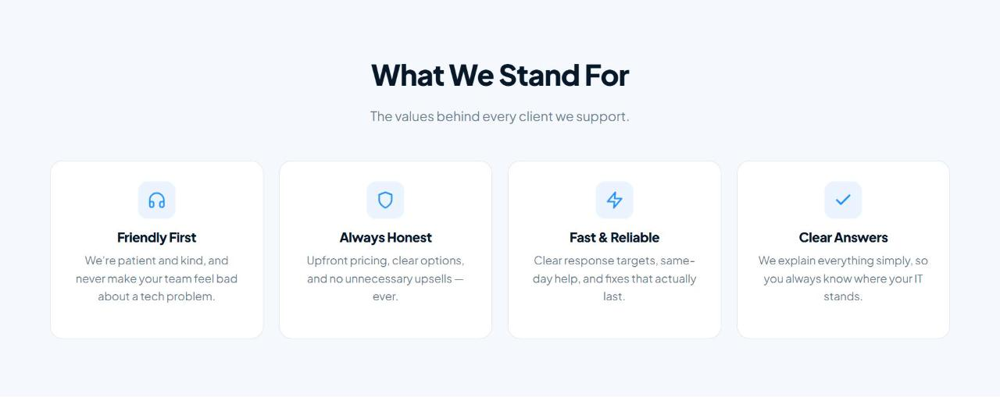

### Contact
Contact cards, a contact form, and panels for support hours, response time and the service area.

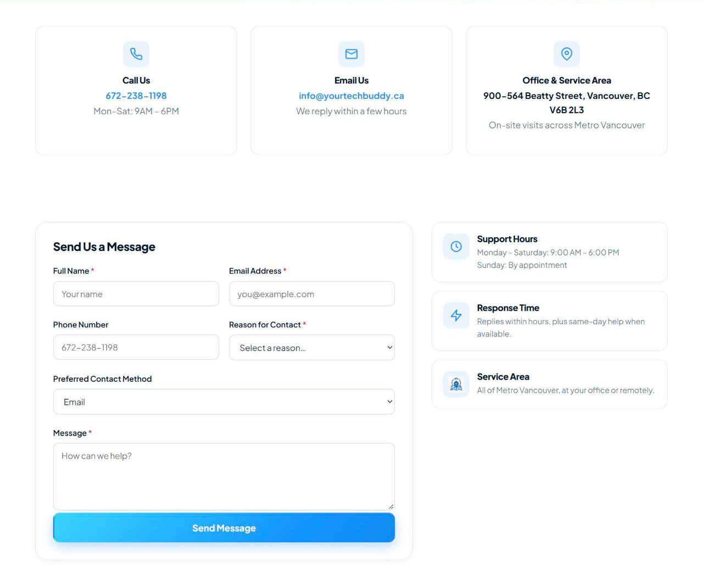

### Tech Tips
Short how-to guides for small offices that can be filtered by topic.

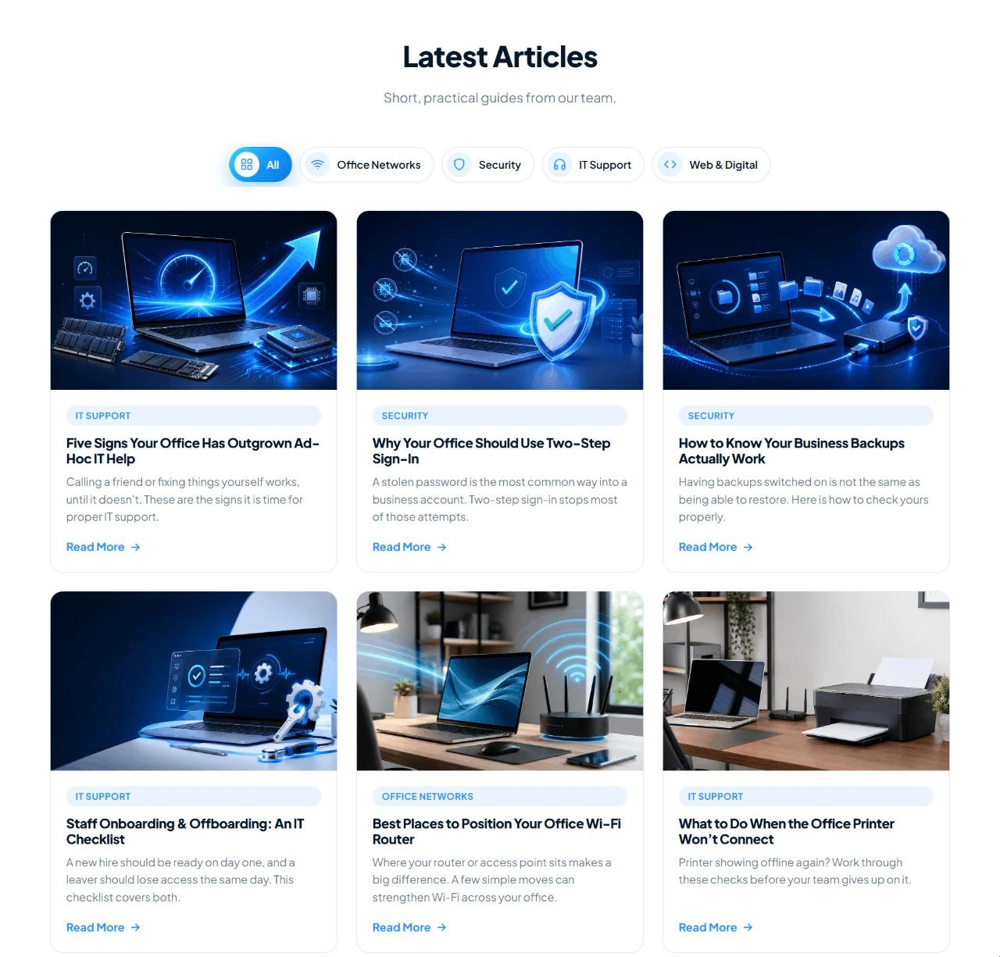

### Online booking
You pick a day from a small calendar, then a time from the slots that are actually free that day.

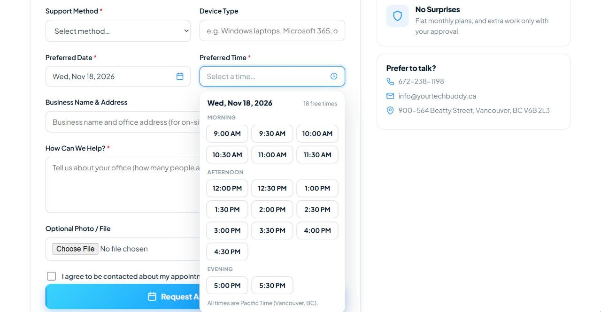

### Admin dashboard
This is where the team runs the site from. The screenshot shows the "What We Help With" tiles for the Web Development page. They can be added, edited, hidden or reordered, and the public page updates as soon as the change is saved.

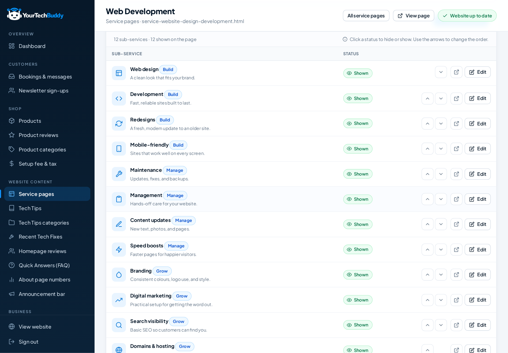

---

## Features

- **Two service pages.** IT Support and Web Development each have a "What We Help With" grid, a few real customer scenarios ("Sound familiar?"), a "Good to Know" section and a four-step "How It Works".
- **Pricing that's easy to compare.** Three IT support plans priced per user per month, three one-time website packages and three monthly website care plans, each shown as a card with what's included.
- **Online booking.** Customers can book a free IT assessment, IT support or web development, on site or remotely. The calendar only offers days and times that are free, based on opening hours, holidays and existing bookings. The customer gets a confirmation email with a reference number and the team gets a copy with all the details.
- **Contact form and newsletter.** Both are saved to the database, and the team gets an email when something new comes in.
- **Product shop.** Products with category filters, up to three photos each, a cart that remembers what you added, and optional setup help. Checkout is a demo, so no payment is taken.
- **Reviews.** Product reviews with star ratings, text and photos. Each review is approved before it goes live, the average rating only counts approved reviews, and the team can reply under a review.
- **Tech Tips.** How-to articles for small offices, written and published from the dashboard.
- **Admin dashboard.** Bookings and messages, newsletter sign-ups (with CSV export), products, reviews, service pages, articles, recent tech fixes, homepage reviews, FAQ, about-page numbers, business details, opening hours and an announcement bar.
- **Fast pages.** Content is kept in the database, but the public pages are published as plain HTML, so they load quickly.
- **Responsive** from 320px phones up to 1920px desktops.

---

## Challenges and solutions

A few of the problems I ran into, and how I dealt with them. When I got stuck I searched around and used AI tools to narrow down the cause, then tested the fix on different devices.

| Challenge | Solution |
|---|---|
| The business changed its focus from home tech support to managed IT for small businesses. | I rewrote the homepage and service pages for business owners, cut the services down to two, and added pricing cards so plans are easy to compare. |
| Visitors had trouble finding the right service when there were too many to choose from. | I grouped the services into clear categories, gave each its own page, and redirected old page addresses so no links broke. |
| Some buttons needed two clicks, because the hover animation moved the card (and the button) away from the pointer. | I made each button's invisible click area larger, so it still catches the click while the card moves. |
| On phones, the current page in the mobile menu sat further right than the other items. | The active link had extra left padding. Removing it lined everything up again. |
| Text on small screens broke in odd places, like a dash starting a new line or "Wi-Fi" splitting in two. | I changed the line-wrapping rules, kept hyphenated words together and rewrote some long messages as two short lines. |
| The team wanted to update content without editing code, but the pages still had to load fast. | The dashboard saves changes to the database and then writes them into the static pages, so visitors still get plain HTML. |
| Picking a date and time meant scrolling through long dropdown lists. | I replaced them with a small calendar and a grid of time slots that only shows free times. Both work with a mouse, touch or keyboard. |
| Two people could try to book the same time slot. | The server checks the slot again before saving. If someone just took it, the customer is asked to pick another time. |
| Product ratings had to be genuine. | Every review is approved before it appears, and the average only counts approved reviews. |
| With this many pages, every change had to work on every screen size. | I checked each change at widths from 320px phones to 1920px desktops, looking for sideways scrolling, clipped text, broken images and missed taps. |

---

## Built with

| Area | Tools |
|---|---|
| Front end | HTML5, CSS3 (custom properties, Grid, Flexbox), vanilla JavaScript |
| Back end | PHP |
| Database | MySQL |
| Hosting | Hostinger |
| Font | Plus Jakarta Sans (Google Fonts) |

---

## Contact

YourTechBuddy provides IT support and websites for small businesses across Metro Vancouver.

- **Website:** [yourtechbuddy.ca](https://yourtechbuddy.ca)
- **Email:** info@yourtechbuddy.ca

If you'd like to look at the source code for a job application, please get in touch.

© 2026 YourTechBuddy. All rights reserved. See [LICENSE](LICENSE).
